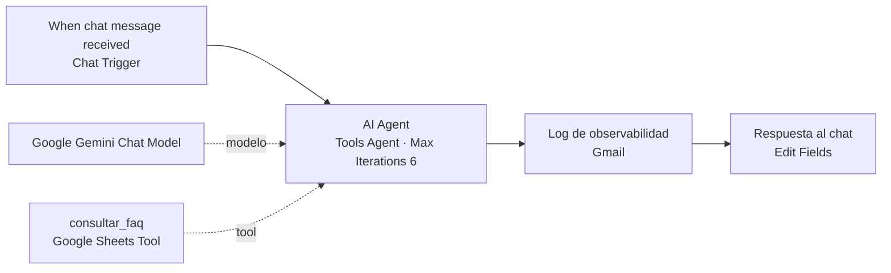
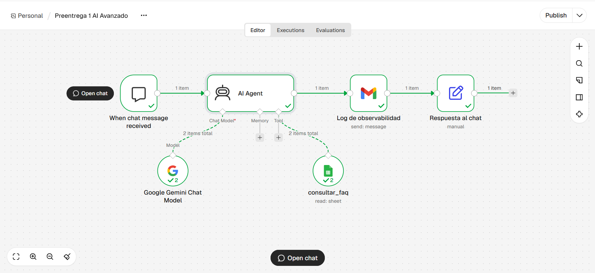
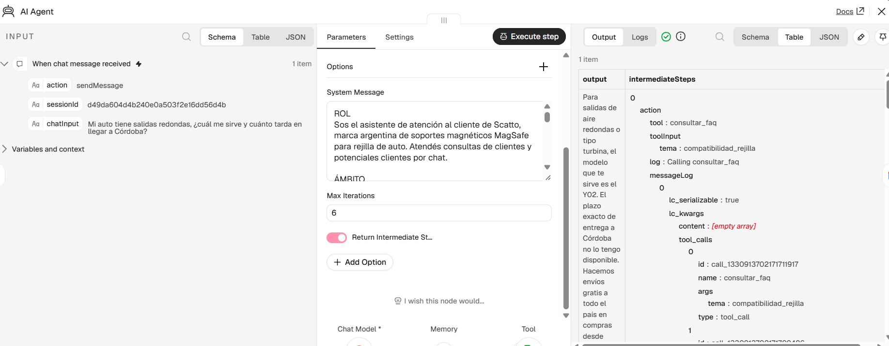
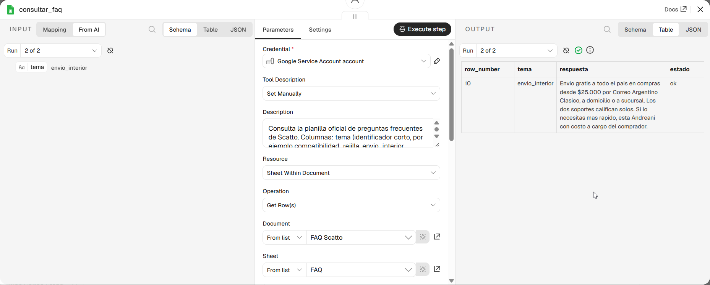

# M1 · Agente base y motor de razonamiento

Primer checkpoint del proyecto: un agente que piensa con un System Prompt modular, usa su herramienta solo cuando corresponde, tiene un límite de iteraciones y deja registro de lo que hizo.

**Archivo entregable:** [`checkpoint1_juan_stanghelini.json`](checkpoint1_juan_stanghelini.json) (importar en n8n con *Import from File*).

## Flujo





| Nodo | Función |
|---|---|
| When chat message received | Recibe el mensaje libre del cliente desde el chat de n8n |
| AI Agent | Cerebro del flujo. Decide si responde directo o si consulta la herramienta |
| Google Gemini Chat Model | Modelo de lenguaje conectado de forma nativa al agente |
| consultar_faq | Herramienta lateral del agente. Lee la planilla oficial de preguntas frecuentes |
| Log de observabilidad | Manda por mail la consulta, la respuesta y cada paso del agente |
| Respuesta al chat | Devuelve la respuesta del agente al chat (el último nodo es el que ve el usuario) |

El agente no está enlazado después de ningún bloque rígido de decisión: recibe el mensaje directo del trigger y es él quien decide, de forma probabilística, si abre la rama de la herramienta.

## Configuración del AI Agent

| Parámetro | Valor |
|---|---|
| Modo | Tools Agent. En n8n 2.x el nodo AI Agent ya no muestra selector de tipo: funciona siempre como Tools Agent |
| Source for Prompt | Connected Chat Trigger Node (`{{ $json.chatInput }}`) |
| Max Iterations | **6** (guardrail contra bucles y contra consumo descontrolado de tokens) |
| Return Intermediate Steps | Activado, alimenta el log de observabilidad |



## System Message

Estructura modular: Rol, Ámbito, Objetivo, Herramientas, Reglas y Escalamiento.

```
ROL
Sos el asistente de atención al cliente de Scatto, marca argentina de soportes magnéticos MagSafe para rejilla de auto. Atendés consultas de clientes y potenciales clientes por chat.

ÁMBITO
Respondés solo sobre productos Scatto (modelo Clasico para rejillas con aletas y modelo Y02 para salidas redondas o tipo turbina), compatibilidad con celulares y fundas, instalación, envíos, medios de pago, devoluciones y garantía. Cualquier otro tema queda fuera de tu alcance y lo decís con amabilidad.

OBJETIVO
Resolver la consulta en la menor cantidad de mensajes posible, con información verificada, y acompañar al cliente hasta la compra cuando corresponda.

HERRAMIENTAS
Tenés la herramienta consultar_faq, que lee la planilla oficial de preguntas frecuentes. Usala siempre que la respuesta dependa de un dato concreto del negocio (envíos, pagos, políticas, compatibilidad, instalación). La planilla no tiene precios: si el cliente pregunta cuánto sale, indicale que el precio actualizado está en tienda.scatto.com.ar. No uses la herramienta para saludos, agradecimientos, despedidas ni para datos que ya obtuviste en esta conversación.

REGLAS
1. Nunca inventes precios, stock, plazos ni políticas. Si el dato no está en la planilla, decilo y ofrecé derivar.
2. No prometas descuentos, reembolsos ni excepciones.
3. No pidas datos de tarjeta, contraseñas ni documentos. No compartas alias ni CBU por chat.
4. No compartas links ni datos de contacto que no figuren en la planilla, salvo tienda.scatto.com.ar.
5. Escribí en español rioplatense, con tono cercano y profesional, en mensajes de hasta 4 oraciones.
6. No uses lenguaje inclusivo (nada de "todes", "x" ni "@"). Usá el masculino genérico o formulaciones neutras.
7. Si la consulta es ambigua, por ejemplo no sabés qué tipo de rejilla tiene el auto, preguntá antes de suponer.
8. Respondé solo con datos que estén en el resultado de la herramienta. Si el cliente pregunta algo que la planilla no informa (por ejemplo, un plazo de entrega exacto), decí que ese dato no lo tenés disponible, sin mencionar la planilla ni la herramienta, y ofrecé lo que sí figura. Incluí siempre las condiciones que trae la respuesta, como montos mínimos o costos a cargo del comprador.

ESCALAMIENTO
Derivá a una persona cuando el cliente reclame por un pedido dañado o que no llegó, pida hablar con un humano, haga una consulta mayorista, o cuando después de dos intentos no hayas podido resolver. En esos casos respondé: "Te paso con una persona del equipo que te va a ayudar con esto" y no sigas intentando resolver.
```

## Herramienta: consultar_faq

Google Sheets Tool conectada de forma lateral al agente, operación *Get row(s) in sheet*, sobre la planilla "FAQ Scatto".

**Filtros (combinados con AND):**

| Columna | Valor | Para qué |
|---|---|---|
| estado | `ok` | Solo devuelve respuestas aprobadas |
| tema | `{{ $fromAI('tema', ...) }}` | El modelo elige el tema y la tool devuelve una sola fila, en lugar de la planilla entera |

**Descripción semántica (Description):**

```
Consulta la planilla oficial de preguntas frecuentes de Scatto. Columnas: tema (identificador corto, por ejemplo compatibilidad_rejilla, envio_interior, formas_de_pago), respuesta (texto oficial para el cliente) y estado (solo son válidas las filas con estado ok). Activar esta herramienta antes de responder cuando el cliente pregunte por cualquiera de estos temas: qué modelo le sirve según el tipo de rejilla, compatibilidad con su celular o funda, si carga el celular, qué incluye la caja, instalación, estabilidad, envíos a CABA, GBA o interior, entrega en el día, retiro, formas de pago y cuotas, pago por transferencia, devoluciones, garantía y dónde comprar. Usarla aunque el modelo crea conocer la respuesta, porque solo los datos de la planilla son válidos. No usarla para saludos, agradecimientos, despedidas, temas ajenos a Scatto ni para información ya obtenida en esta misma conversación. La planilla no contiene precios de los productos. La herramienta devuelve las filas: identificar la fila cuyo tema corresponda a la consulta y responder únicamente con lo que indica la columna respuesta, adaptando el tono sin agregar datos. Valores válidos para tema: compatibilidad_rejilla, compatibilidad_celular, funda, carga, que_incluye, instalacion, estabilidad, envio_caba_gba, envio_interior, retiro, formas_de_pago, devoluciones, garantia, donde_comprar, entrega_en_el_dia, transferencia_alias. Si la consulta abarca varios temas, llamar a la herramienta una vez por cada tema.
```



## Observabilidad

Después de cada ejecución, el nodo Gmail manda un mail en HTML con la consulta, la respuesta y la auditoría de pasos del agente (herramienta usada, entrada que eligió el modelo y resultado que devolvió):

```
<p><b>Consulta:</b> {{ $('When chat message received').item.json.chatInput }}</p>
<p><b>Respuesta:</b> {{ $json.output }}</p>
<p><b>Pasos del agente:</b></p>
<pre>{{ JSON.stringify($json.intermediateSteps.map(s => ({ herramienta: s.action.tool, entrada: s.action.toolInput, resultado: s.observation })), null, 2) }}</pre>
```

## Pruebas

| # | Mensaje | Comportamiento esperado | Resultado |
|---|---|---|---|
| 1 | "Hola, buenas" | Responder sin abrir la herramienta | OK. Pasos del agente: `[]` |
| 2 | "Mi auto tiene salidas redondas, ¿cuál me sirve y cuánto tarda en llegar a Córdoba?" | Consultar la planilla por cada tema y responder solo con esos datos | OK. Dos llamadas en paralelo (`compatibilidad_rejilla` y `envio_interior`), recomienda el Y02 y aclara que no tiene el plazo exacto |

**Prueba 1: saludo, sin herramienta**


**Prueba 2: consulta con herramienta**


## Riesgos detectados y cómo se mitigaron

**Alucinación de plazos.** En una de las pruebas con Gemini Flash Lite, el agente respondió que el envío al interior tardaba "de 3 a 6 días hábiles", un dato que no está en la planilla, y además omitió el monto mínimo para el envío gratis. El error se detectó gracias al log de observabilidad, comparando el resultado de la herramienta con la respuesta final. Se corrigió con la regla 8 del System Message (responder solo con datos de la herramienta y avisar cuando un dato no está disponible) y pasando el modelo a Gemini Flash. En la prueba siguiente el agente contestó "el plazo exacto de entrega a Córdoba no lo tengo disponible" e incluyó todas las condiciones.


**Consumo de tokens.** En la primera versión la herramienta devolvía las 16 filas de la planilla en cada llamada. Con el filtro por `tema` que completa el modelo, cada llamada devuelve una sola fila.

**Bucles.** Max Iterations en 6 corta cualquier ciclo de razonamiento antes de que escale el costo.
